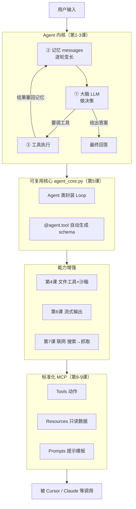

# 从 0 开始学 Agent 底层

一步一步手搓一个 Agent，不依赖任何 agent 框架（LangChain / AutoGen 等），
只用 LLM 的 OpenAI 兼容 API，把 Agent 的底层原理彻底看透。

## 环境准备

```powershell
# 1. 创建并激活虚拟环境
python -m venv .venv
.\.venv\Scripts\Activate.ps1

# 2. 安装依赖
pip install -r requirements.txt

# 3. 配置模型（复制模板后填入你自己的 base_url / api_key / model）
Copy-Item .env.example .env
```

## 核心心智模型

> **Agent = LLM（大脑） + 让它循环「思考→行动→观察」的程序外壳。**

Agent 只有 4 个零件：

| 零件 | 作用 | 代码里对应 |
|------|------|-----------|
| ① 大脑 (Model) | 做决策、生成文字 | 调用 LLM API |
| ② 记忆 (Memory) | 存对话历史和工具结果 | `messages` 列表 |
| ③ 工具 (Tools) | 让 agent 能真正做事 | 普通的 Python 函数 |
| ④ 循环 (Loop) | 把三者串起来反复跑 | `while` 循环 |

## 项目结构

```
agent-step-by-step/
├── agent_core.py          # 共享核心库：可复用的 Agent 类（第 5 课起的地基）
├── lessons/               # 各课代码归档
│   ├── 01_minimal_loop/
│   ├── 02_tool_calling/
│   ├── 03_multistep/
│   ├── 04_file_tools/
│   ├── 05_refactor/
│   ├── 06_streaming/
│   ├── 07_web_tools/
│   ├── 08_mcp/
│   └── 09_mcp_advanced/
├── workspace/             # agent 可读写的沙箱目录
├── .cursor/mcp.json       # Cursor 接入 MCP Server 的配置
└── requirements.txt
```

## 课程进度

| 目录 | 主题 | 学到的东西 |
|------|------|-----------|
| `lessons/01_minimal_loop` | 最小对话循环 | 大脑 + 记忆 + 循环；messages 如何逐轮变长 |
| `lessons/02_tool_calling` | 工具调用 (Function Calling) | 模型如何决定调工具；tool_calls / role=tool |
| `lessons/03_multistep` | 多步推理 | 走一步看结果再走下一步；步数上限安全阀 |
| `lessons/04_file_tools` | 真实世界工具（文件读写） | 让 agent 读写本地文件；沙箱安全边界 |
| `agent_core.py` + `lessons/05_refactor` | 工程化重构 | 抽象出可复用 Agent 类；`@agent.tool` 装饰器从函数自动生成 schema（内省） |
| `lessons/06_streaming` | 流式输出 | 逐字蹦字（`stream=True`）；流式下工具调用碎片的拼接还原 |
| `lessons/07_web_tools` | 联网工具 | 网页抓取（requests+bs4）与搜索（ddgs）；超时/异常/截断等健壮性处理 |
| `lessons/08_mcp` | MCP 协议 | 用 FastMCP 把工具包装成标准 MCP Server，供 Cursor/Claude 等任意客户端调用 |
| `lessons/09_mcp_advanced` | MCP 进阶 | 补齐 Resources（只读数据，≈GET）与 Prompts（提示模板）；厘清 Tool/Resource 区别 |

> 🏆 **里程碑**：学完前 3 课，你已经手搓出了一个完整 agent 的内核。
> 所有主流框架（LangChain / AutoGen / CrewAI）剥到最底层，就是这三份代码做的事。

## 运行方式

```powershell
# 激活虚拟环境后，运行某一课（agent_core 在根目录，各课已自动处理导入路径）
python lessons/01_minimal_loop/01_minimal_agent.py
python lessons/05_refactor/05_refactored_agent.py
```

## 完整架构图（前 9 课串起来）


